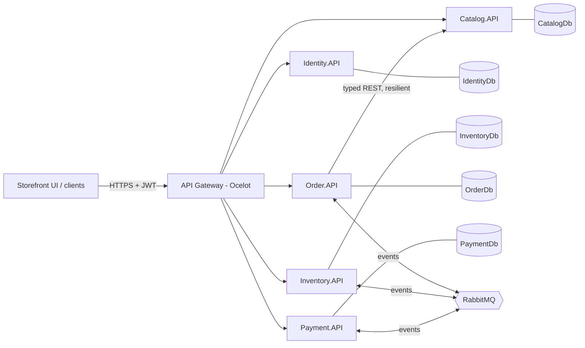
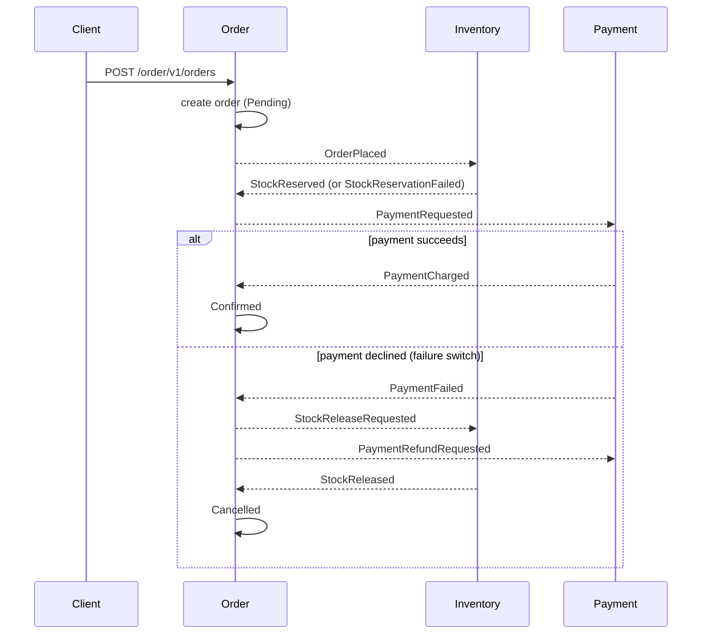

# Online Store Platform

A secured, containerized, event-driven microservices e-commerce backend with a storefront UI.
Placing an order runs a **saga** across services — reserve stock → charge payment → confirm — and
on failure **compensates** (release stock, refund, cancel). Everything sits behind a single
**Ocelot API gateway** that validates JWTs, and the whole system comes up with one command.

## Architecture



**Saga (happy path and compensation):**



## Services & port map

| Component      | Container | Host URL                        | Notes                               |
|----------------|-----------|---------------------------------|-------------------------------------|
| Storefront UI  | 8080      | http://localhost:5080           | Razor Pages; calls the gateway only |
| API Gateway    | 8080      | http://localhost:8080           | Ocelot; the only public entry point |
| Identity.API   | 8080      | http://localhost:5001/swagger   | Register/login, JWT issuance        |
| Catalog.API    | 8080      | http://localhost:5002/swagger   | Products (browse public)            |
| Inventory.API  | 8080      | http://localhost:5003/swagger   | Stock + reservations (events)       |
| Order.API      | 8080      | http://localhost:5004/swagger   | Saga coordinator                    |
| Payment.API    | 8080      | http://localhost:5005/swagger   | Charges/refunds + failure switch    |
| RabbitMQ       | 5672      | http://localhost:15672          | Management UI (guest/guest)         |
| SQL Server     | 1433      | localhost:1433                  | sa / `Your_Strong_Pass123` (dev)    |

Each service owns its **own database** on the shared SQL Server instance (database-per-service).

## Prerequisites

- **Docker Desktop** (the primary, graded path).
- For running outside Docker: **.NET 10 SDK**, a local **SQL Server** (or LocalDB) and **RabbitMQ**.

## Run it (primary path)

```bash
docker compose up --build
```

First run pulls SQL Server + RabbitMQ images and builds seven .NET images, so give it a few minutes.
Startup is health-gated: services wait for SQL Server and RabbitMQ to report healthy, then auto-create
their database and seed data. When everything is up:

1. Open the storefront: **http://localhost:5080**
2. Browse the catalog without logging in.
3. Log in as a seeded user (below) or register a new customer.
4. Place an order and watch its status move `Pending → StockReserved → Confirmed`.
5. To see compensation: sign in as **admin**, open **Payment Switch**, turn failures **ON**, place an
   order, and watch it go `Pending → StockReserved → Compensating → Cancelled`.

### Seeded accounts

| Username  | Password       | Role     |
|-----------|----------------|----------|
| admin     | `Admin123!`    | Admin    |
| customer  | `Customer123!` | Customer |

## Generating EF migrations (one-time, recommended)

The services auto-apply EF Core migrations at startup. If the repo doesn't yet contain migration
files, each service falls back to `EnsureCreated()` so a clone still runs — but to satisfy the
migrations requirement, generate them once (requires the `dotnet-ef` tool):

```bash
dotnet tool install --global dotnet-ef   # if not already installed
# from the repo root:
./scripts/add-migrations.sh              # macOS/Linux
./scripts/add-migrations.ps1             # Windows PowerShell
```

Commit the generated `Migrations/` folders. On the next run the services apply them via `Database.Migrate()`.

## Running a single service outside Docker

Each service reads `ConnectionStrings:Default` (defaults to LocalDB) and, in `Development`, a dev JWT
key from `appsettings.Development.json`. Start RabbitMQ locally (or `docker compose up rabbitmq`), then
`dotnet run` the service. Swagger is at `/swagger`. Note: the **gateway**'s `ocelot.json` uses Docker
service names, so run the gateway via Docker (or edit the hosts to `localhost` + the dev ports above).

## Eventual consistency

This system is **eventually consistent** by design. `POST /order/v1/orders` returns **202 Accepted**
with the order in `Pending`; the saga then advances asynchronously over RabbitMQ. Between steps the
services are briefly out of sync — stock may be reserved before payment is charged, and the order's
status trails the events that have been processed so far.

This is acceptable because:

- **Each step is a local transaction.** Inventory reserving stock, Payment charging, and Order
  changing status each commit atomically in their own database; there is no distributed transaction.
- **Compensation restores consistency on failure.** If payment is declined, the saga releases the
  reserved stock and requests a refund, then marks the order `Cancelled` — so the system never settles
  in a partially-applied state.
- **Messaging is reliable and idempotent.** Events are published with publisher confirms, consumed
  with manual acknowledgement, guarded by a processed-messages table (so redelivery is harmless), and
  dead-lettered rather than dropped on failure. The saga re-publishes the command owed by the current
  state, so a lost message still drives the order to a terminal state.

The client observes convergence by polling `GET /order/v1/orders/{id}` (the storefront order page
auto-refreshes while the saga is in progress).

## Cross-cutting concerns

- **Contract-first:** OpenAPI YAML for every service in [`contracts/`](contracts/).
- **Resilient sync calls:** Order → Catalog uses a typed `HttpClient` with the standard resilience
  handler (retry + backoff + jitter, per-attempt and total timeouts, circuit breaker).
- **Correlation IDs:** an `X-Correlation-ID` is created at the edge, propagated on outbound HTTP calls
  and in message headers, and logged via `BeginScope` so one request is traceable end to end.
- **Problem Details:** a global exception handler returns RFC7807 responses for 400/401/403/404/409.
- **Security:** the gateway validates JWTs before forwarding; browse/register/login are public, order
  and admin routes are protected; admin-only actions return **403** for customers and **401** for
  anonymous callers. Login is **rate-limited** at the gateway.

## Troubleshooting

| Symptom | Fix |
|---|---|
| `docker compose up` slow on first run | Normal — it pulls SQL Server/RabbitMQ and builds 7 images. |
| A service restarts a few times at start | Expected while SQL Server/RabbitMQ finish booting; the service retries the DB connection and settles. |
| SQL Server container unhealthy | The SA password must meet complexity. Override with `SA_PASSWORD` in a `.env` (see `.env.example`). |
| `401` on a protected call | Log in and send `Authorization: Bearer <token>`; the gateway rejects anonymous calls to order/admin routes. |
| `403` as a customer on admin actions | Expected — those require the Admin role. |
| Order stuck in `Pending`/`StockReserved` | Check RabbitMQ (http://localhost:15672) queues and the Inventory/Payment logs; a failed handler dead-letters to `<queue>.dlq`. |
| NuGet restore fails on a package version | Package versions are pinned for .NET 10; if your SDK needs a different Swashbuckle/Ocelot/Asp.Versioning build, adjust the version in the `.csproj` and re-restore. |
| Port already in use | Stop the conflicting process or change the host port mapping in `docker-compose.yml`. |

## Repository layout

```
src/
  Gateway/ApiGateway            Ocelot gateway (JWT, routing, rate limiting)
  Services/Identity.API         auth + JWT issuance
  Services/Catalog.API          products
  Services/Inventory.API        stock + reservations (event consumer)
  Services/Order.API            saga coordinator (event consumer + typed client)
  Services/Payment.API          charges/refunds + failure switch (event consumer)
  Shared/Store.Shared.Events    integration event contracts + bus topology
  Shared/Store.Shared.Common    messaging, correlation, problem details, JWT, DB bootstrap
  Storefront/Storefront.UI      Razor Pages UI (gateway only)
contracts/                      OpenAPI .yaml per service
Postman/                        Postman collection + environment
Evidence/                       screenshots / screencast of the acceptance flows
scripts/                        migration + commit helper scripts
docker-compose.yml              the whole system, one command
```
